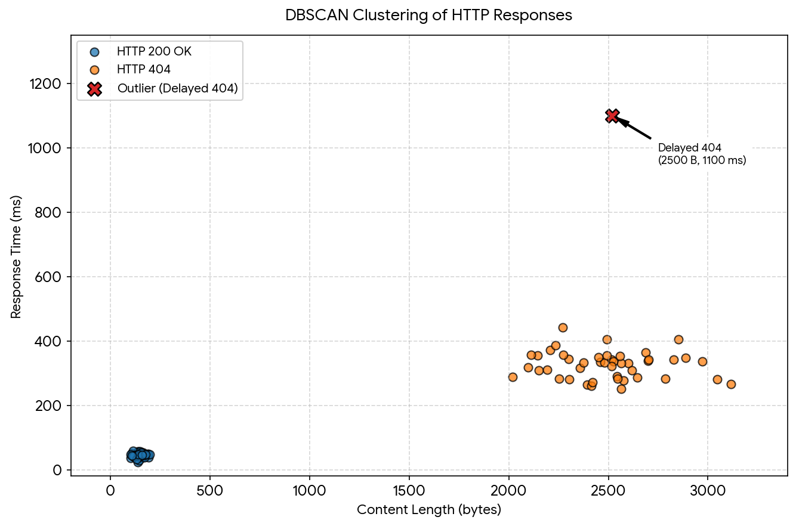

# webfuzzy

A web security testing tool for vulnerability hunting against HTTP endpoints. Webfuzzy bridges automated analysis and manual testing by speeding up outlier-based fuzzing with DBSCAN clustering.

Webfuzzy is still a work-in-progress, and needs a few more features before its fully ready. Currently limited to a single payload position per-run.

Build with `cargo build`. Quick start:

```
cargo run -- --url https://target/api/v1/get?id=§1§
```

Section sign (§) characters can be added to the command line with `ctrl+shift+u a7` on most Linux systems. 

# Usage

```
Web security testing tool for vulnerability hunting against HTTP endpoints

Usage: webfuzzy [OPTIONS]

Options:
  -u, --url <URL>
          Target URL (omit together with --report to re-analyze a previous run offline)
  -H, --header <HEADERS>
          HTTP headers in format 'Name: Value' (repeatable). Wrap the original value in marker pairs to fuzz it, in the key ('§X-Api§-Key: v') and/or the value ('X-Api-Key: §key§')
  -d, --data <DATA>
          Request body/data (for POST/PUT/etc)
  -X, --request <METHOD>
          HTTP method (GET, POST, PUT, DELETE, etc.) [default: GET]
      --baseline-count <BASELINE_COUNT>
          Number of baseline requests to send [default: 10]
  -w, --wordlist <WORDLIST>
          Fuzzing wordlist file path. Defaults to built-in wordlist
  -o, --output <OUTPUT>
          Output directory for logs [default: .]
      --marker <MARKER>
          Payload span delimiter (default: §). Wrap the original value of a fuzzable parameter in a marker pair, e.g. `?id=§1§`: baseline requests send the original value without markers (`?id=1`) and fuzzing runs replace the whole span (markers and original value) with the payload [default: §]
      --threads <THREADS>
          Number of concurrent requests for fuzzing (lower values improve timing analysis accuracy) [default: 5]
      --timeout <TIMEOUT>
          Request timeout in seconds [default: 30]
      --skip-baseline
          Skip baseline testing
  -v, --verbose
          Verbose output
      --max-clusters <MAX_CLUSTERS>
          Maximum number of clusters to report [default: 6]
      --disable-timing
          Disable timing analysis
      --timing-jitter <TIMING_JITTER>ms
          TTFB jitter floor in ms: any status family's TTFB jitter below this is raised to it, so normal endpoint wobble is absorbed into the bulk. TLDR: we don't really care about ~50ms of wobble by default [default: 50]
      --report <REPORT>
          Offline re-analysis: read a previous run's end-of-run report file (report_*.json, or report_*.json.xz for runs auto-compressed for size), re-compute the DBSCAN clustering from the recorded responses, and display the results without sending any requests.
  -h, --help
          Print help (see more with '--help')
  -V, --version
          Print version
```

# Architecture

- DBSCAN clustering of response data to classify endpoint behaviour quickly, and find outliers (noise). - Curl argument interop. Arguments are as-close-as-possible to `curl`, so any tool that offers a `copy as curl` function (browsers, testing tools) can easily be pasted into a webfuzzy run
- Sensible defaults, aiming for minimal runtime configuration.
- Auditability. All HTTP requests and responses sent/recieved by webfuzzy are written to a real-time `jsonl` audit log in the current directory by default. If the user needs to investigate some condition such as a server crash, this log contains all data sent/recieved by the `http_client.rs` HTTP client. When the log exceeds 1MB it is automatically xz-compressed since full-payload logs get large fast.
- Reanalyzing Data. When a fuzz run is complete, this data should be analysable with different clustering parameters without re-running the tool again. At the end of each run a `report_*.json` file is written alongside the audit log, containing the scan metadata, baseline, and the full fuzzing result (response features + clustering). `--report <file>` re-computes the clustering from that file offline, which lets the user analyse an existing run with different `--max-clusters`/`--disable-timing`/`--timing-jitter` settings. Reports larger than 1MB are automatically saved xz-compressed as `report_*.json.xz`; `--report` accepts that form directly and decodes it on the fly.

# Clustering

WebFuzzy uses DBSCAN to cluster response data into groups, with the aim of quickly identifying how a target API or application behaves.

Here is a quick PNG that simplifies the concept with only two features (two dimensions):



The above shows a stable 200 response, a 404 response that has variable content lengths (likely reflecting the input payload), and a timing outlier that warrants further investigation.

Current features used for clustering are:

- Status Code - applied categorically, clustering is run per-status code since a difference of HTTP/200 and HTTP/201 is a very meaningful difference for an API. Euclidian distance between response data points for HTTP/200 and HTTP/201, for example, shouldn't be clustered together. When the code and this readme reference a 'status code family' or 'family', this is what it's talking about.
- Response content length in bytes.
- Time-to-first byte timing data.
- Response content word count.
- Response content line count.
- Response content type, one-hot encoded. One column per common response type (the list lives in `wordlists/content_types.txt`, one type per line), plus one column for missing content-type headers and one for types not on the list.

These raw values are not directly comparable (bytes vs milliseconds vs counts), so each status family is z-scored against its own mean and standard deviation before DBSCAN runs (think [StandardScaler](https://scikit-learn.org/stable/modules/generated/sklearn.preprocessing.StandardScaler.html)). That also does the right thing for the one-hot content-type columns: a type used by only a few responses sits many sigma away from the bulk, so a handful of `application/json` responses among `text/html` split into two clusters, and a single weird content-length is an outlier. Content-type matching ignores parameters (`text/html; charset=utf-8` matches the `text/html` column) but is case-sensitive on purpose: a server answering `Text/HTML` is weird and we want to see that.

Two further adjustments keep the length and timing features from producing false outliers:

- TTFB jitter scaling. Timing on a fast network is dominated by millisecond-scale wobble. The family that matches the baseline's mode status is scaled against the baseline's own mean and standard deviation (a control group of un-injected requests), and every family's TTFB standard deviation is floored at `--timing-jitter` (default 50 ms). TLDR: by default we don't really cluster on timing thats less than ~50ms of wobbly.
- Reflection regression. An endpoint that reflects the input payload (think reflected XSS) makes response length track payload length, which fragments the clusters into one point per payload length. When reflection is detected within a family, the length feature is replaced by the regression residual (`content_length - slope * payload_length`) and word/line counts are squashed to zero. See [Reflecting Endpoints](#reflecting-endpoints) for how detection and the slope work.

A deliberate side effect of the reflection handling: payloads whose encoding the server transforms (heavy percent-encoding, charset tricks) decode to a different fraction than the population average and keep a residual, surfacing as small clusters or outliers. This is intentional! These are the payloads worth a human look since they indicate some form of encoding/decoding behaviour that's worth investigating!

The goal is 'weird handling of data, or odd encoding' gets its own cluster or gets flagged as an outlier.

# Reflecting Endpoints

If the endpoint reflects the input (reflected XSS being the classic vulnerability case), response length grows with payload length. This disrupts the clustering since content length is going to change depending on the input length, and small interesting deviations are hidden in the noise. So webfuzzy detects and measures reflection, subtracts it from the response length, and clusters on what is left over (the "residual"). Two estimators are involved:

**Spearman rank correlation (rho) - "does the response track my payload?"** For each status code, webfuzzy ranks the payload lengths and the response lengths, and correlates the ranks (Spearman correlation). The result is a single number from -1 to 1: how consistently the longer payloads get the longer responses. 0.8 or more is judged as reflecting (though this was picked as an arbitrary starting point, and may change with more testing). This is the number you see in the summary line (`Payload-response correlation (HIGH...): 0.88`) and in the report (`Reflection detected on status 200 (rho = 0.89)`

Spearman was chosen since it's robust to outliers. One payload that triggers a 250KB stack-trace dump only takes a single rank slot at the top of the list. A plain (Pearson) correlation didnt tolerate that condition and a few giant error pages among ~1100 responses would drag the number from 0.99 down to like 0.02, the tool would conclude "no reflection", and the analysis would silently go wrong. Spearman is resilient to this condition.

**Theil-Sen slope - Identifying the size of the reflection** Only applied for status code families where reflection was detected. This is the median of the slopes between all pairs of (payload length, response length) points, in response bytes per payload byte. Read this number as information about the target reflection behavior in general. A slope of ~3 says the input is written into the response in three places; a slope of ~0.5 says the server transforms it (decodes, re-encodes, strips) before echoing it back. This slope is calculated as a single number for each status code family and used in the residual calculation (the "slope").

The tool subtracts `slope * payload_length` from every response length. What remains is the residual. The part of the response that doesn't contain the reflected payload. Payloads that are echoed cleanly all land at the same residual, so a thousand reflected responses of every size form one cluster. Anything that deviates (input that was truncated, encoding that was transformed, an error page that grew) all keep a residual and show up as an outlier with a sigma tag.

Each reflecting cluster also reports the residual spread across its members in the webfuzzy output (eg `Reflection residual: mean 598, min -7040, max 622 bytes`): a uniform residual (all values the same) means every input payload was reflected in the same way, while a spread of values shows variance in the clusters members. A spread (different mean,min,max values) could indicate the cluster includes anomalies too mild to become outliers or new clusters themselves! If you see a spread here, it could mean some kind of minor encoding processing differences in the target, or additional data getting appended for a given input. Major differences should form their own clusters either way, but the reflection residual numbers help catch more nuanced endpoint behavior. If you see variance in the residual numbers, it could be worth investigating that cluster's payloads more closely to understand what transformation is happening.

Word and line count features are squashed to zero for reflecting status code families, since the reflected payload drives them too and the server's mapping is unknown.

# License

Webfuzzy is released under BSD 3-Clause. See [LICENSE](https://github.com/denandz/webfuzzy/blob/main/LICENSE).
